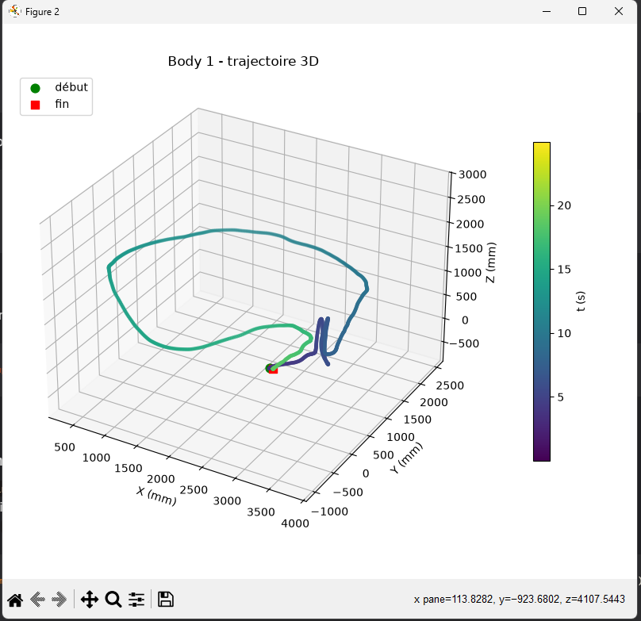
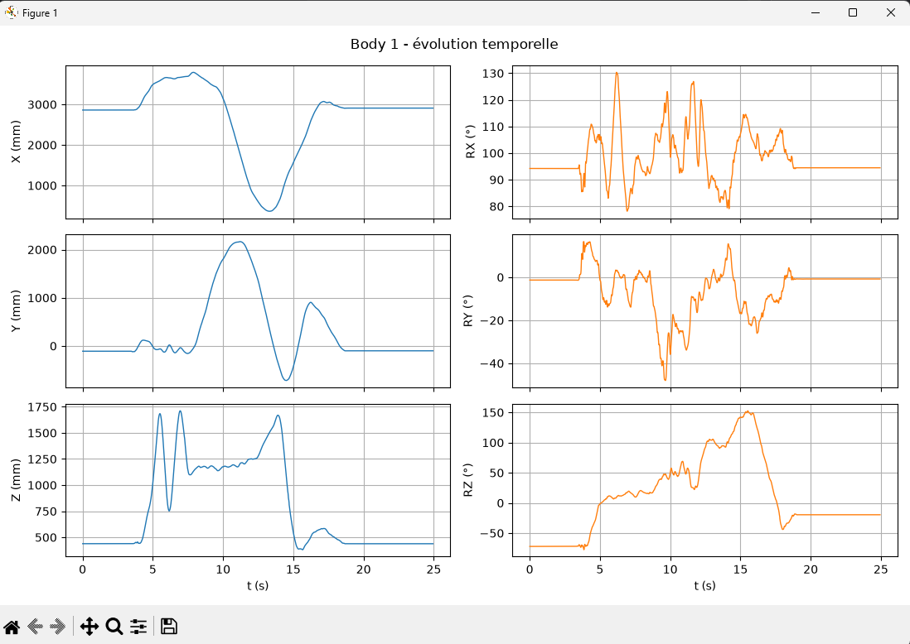

# Motion Capture Camera ART — Recorder

Enregistreur C++ de flux DTrack (ART) avec visualisation optionnelle (Python).
<p align="center">
  
  
  
</p>
## Prérequis

### C++ (build de `record.exe`)

- **CMake ≥ 3.25** (4.x recommandé)
- **Ninja** + **MinGW-w64 (g++)** — configuration par défaut
  ```powershell
  winget install Kitware.CMake
  winget install Ninja-build.Ninja
  winget install MSYS2.MSYS2   # puis : pacman -S mingw-w64-ucrt-x86_64-gcc
  ```
- *Optionnel* : **Visual Studio 2022** (ou Build Tools) avec la charge "Développement Desktop en C++" pour les presets `vs2022-*`
- **git** (pour le submodule)

### Python (visualisation `visualize.py`)

- **Python 3.12** (contrainte `requires-python` de `pyproject.toml`)
  ```powershell
  winget install Python.Python.3.12
  py -3.12 --version     # doit afficher Python 3.12.x
  ```
- **Poetry** (gestion des dépendances Python)
  ```powershell
  # Méthode officielle via pipx
  python -m pip install --user pipx
  pipx ensurepath        # puis fermer/rouvrir le terminal
  pipx install poetry
  poetry --version
  ```
  Alternative : \`(Invoke-WebRequest -Uri https://install.python-poetry.org -UseBasicParsing).Content | python -\`

## Installation

```powershell
# Cloner avec le submodule DTrackSDK
git clone --recursive https://github.com/tintin75011/Motion_Capture_Camera_ART_Recorder.git
cd Motion_Capture_Camera_ART_Recorder

# Si le clone a été fait sans --recursive :
git submodule update --init --recursive
```

## Build (C++)

Lister les configurations disponibles :

```powershell
cmake --list-presets
```

Configurer + compiler (Ninja / MinGW, Release) :

```powershell
cmake --preset ninja-release
cmake --build --preset ninja-release
```

Variante Debug :

```powershell
cmake --preset ninja-debug
cmake --build --preset ninja-debug
```

Avec Visual Studio 2022 :

```powershell
cmake --preset vs2022-release
cmake --build --preset vs2022-release
```

## Utilisation

```powershell
.\build\record.exe [hostname] [port]
# ex: .\build\record.exe 192.168.1.10 50105
```

## Visualisation Python (`visualize.py`)

`visualize.py` trace les données enregistrées avec **matplotlib / numpy / pandas**.

### Installer les dépendances Python (avec Poetry)

Poetry crée **lui-même** le virtualenv : pas besoin de `python -m venv` à la main.

```powershell
# 1. Créer le venv dans le projet (.venv/ à la racine du dépôt)
poetry config virtualenvs.in-project true

# 2. Forcer Python 3.12 pour ce projet
poetry env use 3.12
# si introuvable, donner le chemin complet :
# poetry env use "$env:LOCALAPPDATA\Programs\Python\Python312\python.exe"

# 3. Créer le venv + installer les dépendances + générer poetry.lock
poetry install
```

> `pyproject.toml` déclare les dépendances, `poetry.lock` (généré, **à committer**) fige les versions exactes.  
> Pour ajouter une dépendance plus tard : `poetry add <paquet>` — cela met à jour `pyproject.toml`, `poetry.lock` **et** installe le paquet en une commande.  
> Ne faites **pas** `pip install <paquet>` dans le venv : le paquet serait installé mais déclaré nulle part, et `poetry sync` le supprimerait.

### Lancer le script

```powershell
poetry run python .\visualize.py
```

ou en activant le venv :

```powershell
.venv\Scripts\Activate.ps1
python .\visualize.py
```

## Tests

```powershell
ctest --preset ninja-release
```

## Structure du projet

```
Motion_Capture_Camera_ART_Recorder/
├── CMakeLists.txt          # point d'entrée CMake
├── CMakePresets.json       # configurations de build prédéfinies
├── pyproject.toml          # dépendances Python (Poetry)
├── poetry.lock             # versions Python verrouillées — À COMMITTER
├── visualize.py            # script de visualisation (matplotlib/numpy/pandas)
├── .venv/                  # environnement virtuel Python — ignoré par git
├── .vscode/
├── src/
│   └── record.cpp          # exécutable enregistreur (C++)
├── DTrackSDK/              # submodule — SDK ART (ne pas modifier)
├── build/                  # généré (Ninja) — ignoré par git
└── build-vs/               # généré (VS) — ignoré par git
```

`.gitignore` doit contenir au minimum :

```
.venv/
build/
build-vs/
```

## Notes

- Le SDK est épinglé à un commit précis via `.gitmodules` : mettre à jour avec
  ```powershell
  git submodule update --remote DTrackSDK
  ```

## Dépannage

### `ninja` ou `g++` introuvable après installation

Après un `winget install`, le `PATH` n'est pas mis à jour dans les terminaux déjà ouverts.  
Fermer puis rouvrir le terminal (ou redémarrer VS Code complètement) suffit en général.  
Pour recharger le `PATH` sans fermer la session :

```powershell
$env:Path = [System.Environment]::GetEnvironmentVariable("Path","Machine") + ";" + [System.Environment]::GetEnvironmentVariable("Path","User")
ninja --version
g++ --version
```

> `g++` installé via MSYS2 se trouve dans `C:\msys64\ucrt64\bin` : ce dossier doit être dans le `PATH`.

### `Does not match the generator used previously`

Le dossier `build/` a été généré avec un autre générateur (Visual Studio, par exemple).  
Le supprimer puis relancer la configuration :

```powershell
Remove-Item -Recurse -Force build
cmake --preset ninja-release
```

### `ModuleNotFoundError: No module named 'matplotlib'` alors que `pip install matplotlib` répond "already satisfied"

C'est le piège `python3` sous Windows (voir section Visualisation) : `pip` installe bien dans `.venv`,  
mais `python3` exécute le Python global. Lancer le script avec `python .\visualize.py`  
(ou `poetry run python .\visualize.py`), et vérifier `python -c "import sys; print(sys.executable)"`.

### `poetry install` échoue ou choisit la mauvaise version de Python

```powershell
poetry env info                 # voir quel Python est utilisé
poetry env use 3.12             # forcer Python 3.12
poetry env remove --all         # repartir à zéro si besoin
poetry install
```